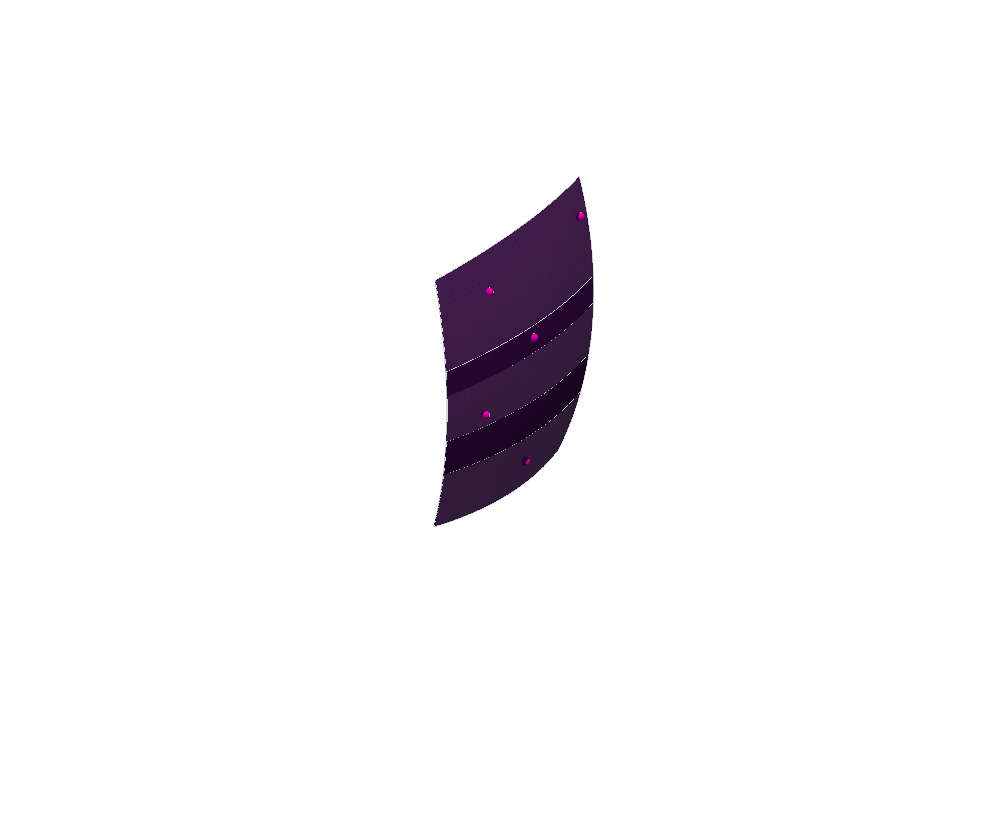
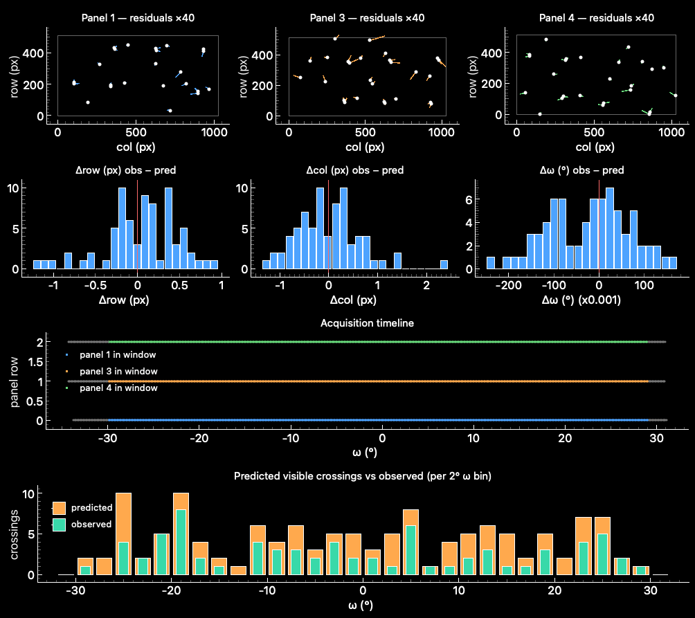
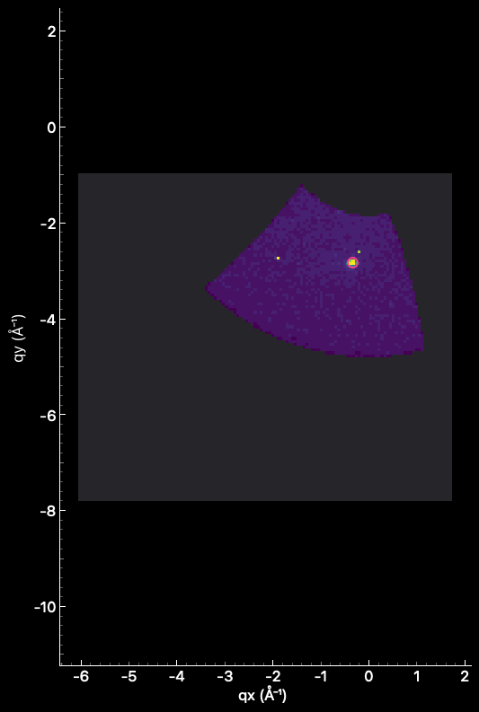
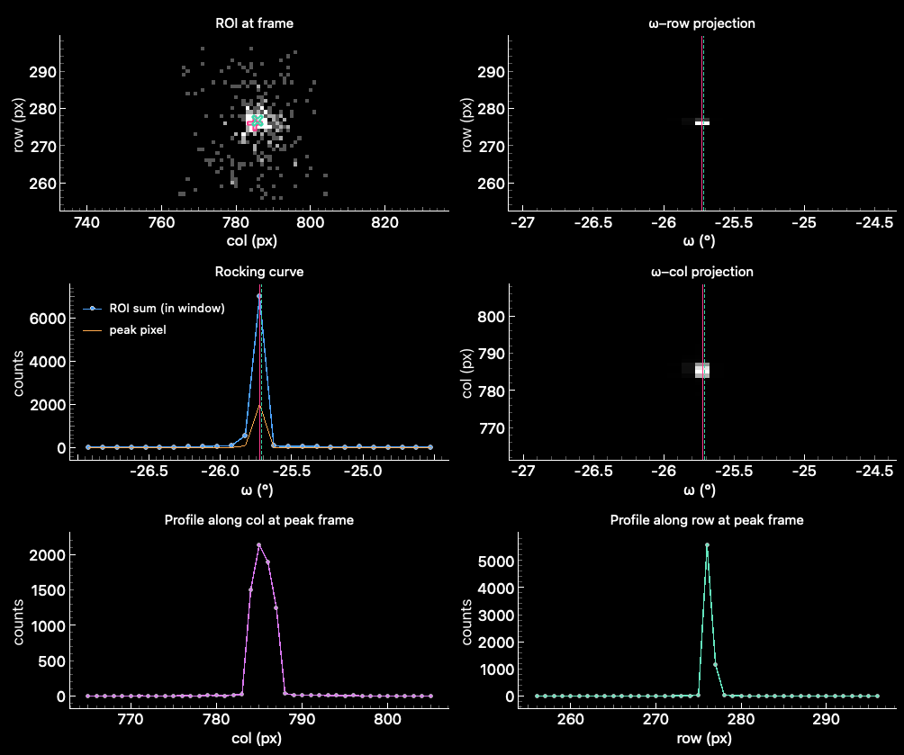
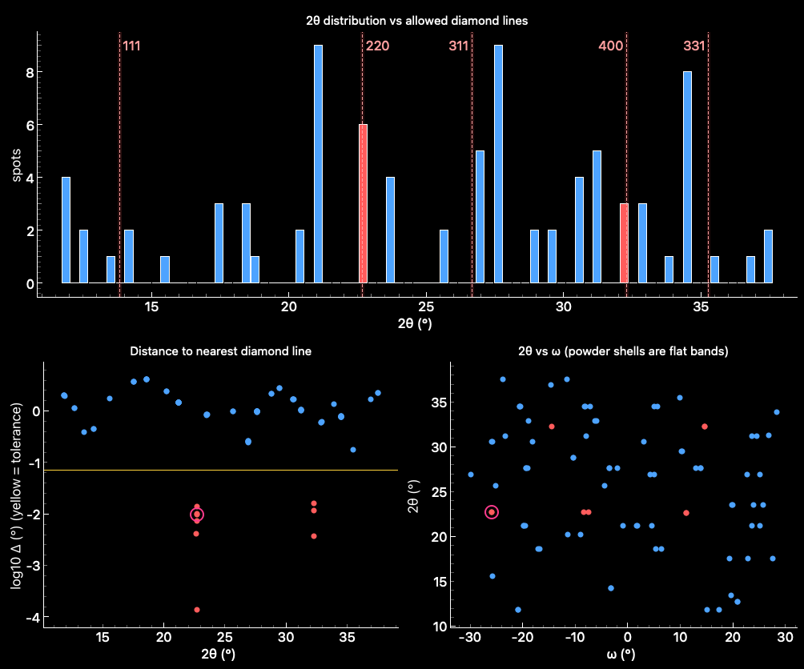
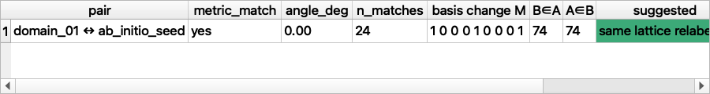
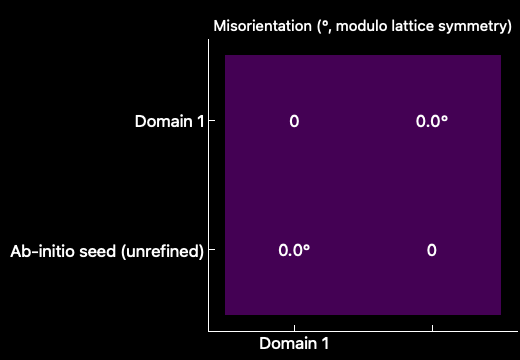

# 1. Scope and how to read this document

The Solve Cell tab takes raw rotation-series frames from one or more detector panels, finds diffraction spots, removes diamond and gasket contamination, and indexes what remains into one or more crystal domains. This document describes the views that sit on top of that analysis – the existing reciprocal-space map and detector view, plus the views added on the `solve_cell_vis` branch – and, for each of them, which numbers are plotted, which equations produce them, which approximations were made, and where the data come from. It is written for a user who needs to decide how far a given picture can be trusted, and for a developer who has to extend or debug a view.

Every example number below was measured on the local test project `test_data/projects/s3idc_oct8_spinel.h5` (a spinel sample in a diamond anvil cell, three Eiger panels of 512 × 1028 pixels with a 75 µm pixel, λ = 0.49594 Å, 86 spots, one refined triclinic domain whose conventional cell is cubic with a ≈ 7.95 Å). Nothing here has been averaged over other datasets, and no value has been carried over from a different experiment.

Two terms are used throughout. A *product* is a derived data set that a view needs (for e.g. the forward predictions, or the reciprocal-space volume) and that is stored in the project file so that the view can be shown without re-running the analysis (§2.5). An *approximation* is a deliberate quick-look choice – each is named where it is made and is also written into the metadata of the stored product, so that it can be read back from the file itself.

# 2. Conventions shared by every view

## 2.1 Coordinates, units and the Ewald sphere

The incident beam travels along laboratory $+X$. A pixel's scattering vector in the laboratory frame is

```
k0     = 2π / λ                       (Å⁻¹)   # 12.669 Å⁻¹ at λ = 0.49594 Å
ki     = k0 · (1, 0, 0)
kf     = k0 · (unit ray from sample to the pixel)
q_lab  = kf − ki
```

so that `|q_lab + ki| = k0` – the elastic Ewald condition. All reciprocal-space coordinates in this tab are in units of 2π/d (Å⁻¹), i.e., `|q| = 2π/d`, and *not* in 1/d; the fitted orientation matrix is stored in 1/d and is converted with

```
q_pred = 2π · UB @ hkl          hkl_float = solve(UB, q / 2π)          d = 2π / |q|
```

Plotted reciprocal coordinates are in the *sample* frame, `q_sample = Rᵀ(ω) · q_lab`, wherein the crystal lattice is fixed and the Ewald sphere moves. In this frame the sphere has centre `−Rᵀ(ω) ki`, radius `k0`, and always passes through q = 0. The rotation and the pixel-to-q mapping are the tested `midas_defect.geometry` routines (`pixel_to_qlab`, `qlab_to_qsample`, `qsample_to_qlab`, `qlab_to_pixel`, `ewald_crossings`); the GUI does not re-implement the rotation matrix. Only the tilts `ty` and `tz` from the calibration file are propagated by Solve Cell, with `tx = 0` and no distortion or wedge; for the three calibrations in the test project, the calibration files themselves record `tx = 0` and zero distortion coefficients, so nothing is lost here, but that statement has to be re-checked for any other beamline calibration (§11).

## 2.2 Frames and omega

The ingest stage keeps only the frames inside the user-set omega window, and assigns each loaded frame the nominal angle

```
ω(idx) = ω_ref + (idx − idx_ref) · Δω
```

i.e., the recorded value is treated as the frame's own omega with no half-step added. A spot's omega is then interpolated at its fractional centroid frame. Every later view uses the same convention. Thus, the numbers in the frame manifest, the spot table, the predictions, the volume and the frame patches are mutually consistent; whether the beamline's recorded omega is an exposure start, centre or end is *not* known to the software, and any constant offset would appear as a mean residual in ω (§5.1).

`loaded_frame_idx` addresses the original loaded stack (what the Data Loader scrub bar indexes), whereas `spots.frame` addresses the kept stack after window and live-frame filtering; they are not interchangeable and the views use `loaded_frame_idx` throughout.

## 2.3 Pixel coordinates and image orientation

Raw detector pixels are mapped into the calibration frame with the ordered `im_trans` operations (1 = flip Y, 2 = flip Z, 3 = transpose) before the geometry is evaluated; predictions travel back through the inverse operations in reverse order. Pixel centres sit at integer indices and pixel *edges* at `i − 0.5`. Every view draws pixel (0, 0) at the bottom-left, with x = column and y = row and y increasing upward, as in the other MIDAS viewers.

## 2.4 Intensity semantics

Three different quantities appear in the views and they are never mixed. Counts of a spot's *integrated* intensity (`integrated`, `peak_counts`) are spotfinder blob sums that were produced at ingest. *Background-subtracted counts* in the volume, the frame patches and the spot inspector are `frame − B`, wherein `B` is a static per-pixel median over every eighth in-window frame of a panel (the ingest stage's sector-based background is not retained, so it cannot be reproduced after the fact). *Raw counts* are shown as recorded. Negative background-subtracted values are kept in the stored arrays; log or asinh scaling is applied only when a picture is drawn. Masked pixels and the detector sentinel value (4294967295 for `uint32` frames) are excluded everywhere and are drawn as *missing*, not as zero. None of these quantities is a calibrated structure-factor intensity: no dark, bright, polarization, solid-angle, absorption or monitor correction is applied in any view.

## 2.5 Where the data live in the project file

The latest Solve Cell analysis is one record at `/analysis/solve_cell`, with an `ingest/`, a `diamond/` and an `index/` section. The visualization products are stored beside them in `/analysis/solve_cell/viz/<product>/`, each with a JSON `metadata` dataset, optional `tables/` (compound datasets) and optional `arrays/` (gzip-compressed). Opening a project restores the record and the products, and each tab shows its view from the stored product; a product is computed only if it is missing or out of date.

| Product | Contents | Used by | Size in the test project |
|---|---|---|---|
| `frame_manifest` | one row per loaded frame per panel: ω, in-window flag | Diagnostics (timeline), Ewald/patch ω range | 0.02 MB |
| `domain_NN_predictions` | all Ewald crossings of the domain's UB (`predictions`), observed − predicted residuals (`residuals`), UB, q_max | Reciprocal overlays, Diagnostics, Spot inspector | 0.07 MB |
| `reciprocal_volume` | `sum`, `count`, `max` on a voxel grid, grid spec, approximations | Volume tab | 3.04 MB |
| `spot_shoeboxes` | raw and background-subtracted ROI cube for every spot | Spot inspector | 0.93 MB |
| `frame_patches` | block-max cell signal of every in-window frame of every panel | Frame-patch overlay | 4.29 MB |
| `domain_comparison` | per-lattice table, pairwise comparison table | Compare domains | < 0.01 MB |
| `domain_review` | reviewer conclusions with UB fingerprints | Compare domains | < 0.01 MB |

*Invalidation.* A new ingest replaces the whole record (the products were derived from the old spots) and therefore removes all of them. A re-index does *not* remove them; instead, each domain product records the SHA-1 fingerprint of the UB it was computed from, and the tab recomputes it when the fingerprint of the current domain no longer matches. The comparison and the reviewer conclusions carry the fingerprint of every lattice involved, and a stale review is ignored rather than shown. The stored contents of the products add up to about 8.4 MB; the project file grew from 2.1 MB to 14.7 MB, because HDF5 does not reclaim the space of a group that is replaced (each product is written to a staging group and swapped in), and a *Save As* compacts the file.

# 3. Overview: view, tab, product, required input

| View | Tab / location | ID in the research handoff | Product | Needs original frames? |
|---|---|---|---|---|
| Spot map (Panel / Crystal / Q residual colouring) | Reciprocal space map | – | none (spot table) | no |
| Ewald sphere cap | Reciprocal, Overlays | V01 | none (wavelength, ω) | no |
| a\*, b\*, c\* arrows and reciprocal cell | Reciprocal, Overlays | V15 | none (UB) | no |
| Predicted lattice points | Reciprocal, Overlays | V08 | `domain_NN_predictions` | no |
| \|q\| shells | Reciprocal, Overlays | – | none | no |
| Frame patches | Reciprocal, Overlays | V02 | `frame_patches` | only to build the cache |
| Residual vector fields, histograms | Diagnostics | V09 | `domain_NN_predictions` | no |
| Acquisition timeline, predicted vs observed per ω bin | Diagnostics | V11 | `frame_manifest`, predictions | no |
| Volume: 2-D slabs and 3-D isosurface | Volume | V03, V04, V05 | `reciprocal_volume` | only to build the cache |
| Spot inspector | Spot inspector | V10 | `spot_shoeboxes` | only to build the cache |
| Diamond / gasket evidence | Contamination | V12 | none (flagged spot table) | no |
| Domain comparison | Compare domains | V13 | `domain_comparison`, `domain_review` | no |

# 4. Reciprocal-space map and its overlays

## 4.1 The spot map (existing view)

Each ingested spot is one point at its `q_sample = (qsample_x, qsample_y, qsample_z)`, computed at ingest from the blob centroid `(row, col, frame)` as described in §2. Three colouring modes are available. *Panel* colours by source panel, which is the quickest check that a pooled multi-panel ingest has put the panels into one common frame. *Crystal* gives diamond/gasket spots, every solved domain, and the still-unassigned spots their own colours. *Q residual* colours each indexed spot by `|q_observed − q_fitted|` with `q_fitted = 2π UB hkl`, and spots without a refined fit are grey. Point size is either constant or scaled by `√(integrated / max integrated)` between a floor of 35% and 100% of the requested size, so that faint spots stay visible. Hovering reports the spot's panel, frame, ω, row, column and (if indexed) hkl and residuals; clicking selects the spot and drives the Detector view, the Spot inspector and the Contamination view. The *fitted positions* option draws a cross at `q_fitted` and a line to the observed point, for assigned reflections only – it does not predict reflections that were not observed (that is what §4.4 is for).

## 4.2 Ewald sphere (V01)

The sphere is drawn as a *local cap*, because its radius (12.7 Å⁻¹) is large as compared to the plotted data (|q| up to about 8 Å⁻¹) and a full sphere would dominate the scene and the automatic camera. With `n = (cos θ, sin θ cos φ, sin θ sin φ)` a unit vector about the beam direction,

```
q_lab(θ, φ) = k0 · n − ki             θ ∈ [0, θ_max],   φ ∈ [0, 2π)
θ_max       = 2 · asin( q_cap / (2·k0) )
q_sample    = Rᵀ(ω) · q_lab
```

which is a surface through q = 0 whose farthest point is at `|q| = q_cap` (chosen as 1.15 × the largest observed |q|). The ω slider rotates the cap in the sample frame; as a consequence, the lattice points and spots stay fixed and the cap sweeps through them. A yellow arrow shows `ki` ending at q = 0, and a pink line shows the rotation axis. The cap is the *Ewald* sphere; the optional purple wireframe spheres at 0.5, 1.0 and 1.5 Å⁻¹ are constant-|q| *resolution shells* centred on q = 0 and are a different object, which is why they use a different colour and a separate checkbox.

{width=85%}

## 4.3 Reciprocal basis and cell (V15)

The columns of `2π · UB` are a\*, b\*, c\* in the sample frame (red, green, blue arrows from q = 0); the eight corners `2π · UB · (i, j, k)` with `i, j, k ∈ {0, 1}` give the reciprocal unit cell. For a triclinic domain – as here, wherein the refined primitive cell has angles of 119.9°, 60.0° and 119.7° – the arrows are visibly non-orthogonal and their lengths differ, which is the quickest visual check that a basis is not a trivially wrong one. No indexing label is drawn by these actors; HKL assignments are in the hover text and the fit tables.

## 4.4 Predicted lattice points (V08)

The prediction is a forward calculation from a refined UB, independent of what was observed. For a domain with matrix `UB`:

1. every integer `hkl ≠ 000` with `|2π UB hkl| ≤ q_max` is enumerated, where `q_max` is the largest observed |q| of that domain plus 0.05 Å⁻¹;
2. for each, the two ω at which the point crosses the Ewald sphere are the roots of `A cos ω + B sin ω = C`, with `A = q_x`, `B = −q_y`, `C = −|q|² / (2 k0)` (the backend's `ewald_crossings`, zero wedge). No real root means the point is in the blind region and is dropped;
3. each root is lifted by multiples of 360° into every panel's scanned window `[ω_first, ω_last]`, so scans longer than one turn would keep every crossing;
4. at each such ω, `q_lab = R(ω) q_sample` is sent to the detector with the full inverse model (`qlab_to_pixel`: tilts, beam centre, sample-detector distance), and then through the inverse `im_trans` to raw `(row, col)`;
5. the crossing is `visible` if the pixel lies inside the panel, `off_panel` if the ray lands outside it, and `no_intersection` if it misses the detector plane.

The stored table has one row per `(panel, hkl, crossing)` with `h, k, l, panel_id, omega_deg, row, col, crossing (0/1), qx, qy, qz, visibility, observed_spot_id`. An observed spot is matched to a prediction only when it has an assigned hkl, is on the same panel, has the same hkl, and lies within 1° of the prediction in ω (wrapped to ±180°); the match is *reported* and never reassigns a claim.

In the view, each unique hkl is one point (a lattice point does not depend on ω or panel). *Green* points have at least one crossing explained by an assigned spot; *orange* points land on a panel inside the scan but have no assigned spot (the candidates to inspect if a domain is thought to be incomplete); *grey* points never land on any active panel (optional, "incl. off-panel"). The *diffracting now* highlight marks every crossing within ±0.5° of the slider ω. These actors are small and non-pickable, so that they cannot intercept the picking of observed spots. For Domain 1, with `q_max = 8.20 Å⁻¹`, the table has 1154 crossings, of which 130 are visible and 1024 are off-panel; the unique lattice points split into 64 observed, 44 visible-but-unobserved and 277 off-panel. It should be noted that "visible but not observed" does not mean "missing": the spotfinder threshold and the DAC aperture have not been modelled (§11).

## 4.5 Frame patches on the Ewald surface (V02)

This overlay shows what each panel actually measured at the slider ω. For a panel with `n_r × n_c` pixels and an integer stride `s` (8 in the stored cache), the cell grid has corners at the pixel edges `(i·s − 0.5, j·s − 0.5)` (plus the terminal edge, so the last block may be shorter when `s` does not divide the shape). The corner grid is mapped to `q_lab` *once per panel*, through the calibration frame and `pixel_to_qlab`, and is rotated into the sample frame at the frame's own ω, so scrubbing ω costs one rotation of a 65 × 130 point array per panel. Each cell carries

```
cell(i, j) = max over its s×s raw pixels of (frame − B),    masked and sentinel pixels excluded
cell(i, j) = NaN   if every pixel of the block is masked or sentinel
```

The block *maximum* is used rather than the mean so that a sparse Bragg peak is not averaged away when 64 pixels are combined. NaN cells are *removed* from the rendered surface, so a gap between modules, a masked region or a dead strip is a hole, and a measured cell with zero signal is drawn in the lowest colour of the map (a partially masked cell is measured and is kept). The colour is `asinh(cell / 10)`, with one fixed range over all panels so that frames can be compared; each panel's outline is drawn separately so that masked areas still show where the detector is.

Each panel is shown at the loaded frame nearest to the slider ω, `idx = round((ω − ω_ref)/Δω) + idx_ref`, and a panel whose window does not contain that ω is skipped (the status line lists the frame and ω used per panel, since the panels were not scanned with identical `ω_ref`: they differ by up to 0.027° at frame 0 in this project). Selecting a spot moves the slider to that spot's own, fractional ω. A rounded frame centroid can differ slightly from a fractional-ω centroid, which is why the test in §10 allows a tolerance of a fraction of a cell. Clicking on the *patch* to return to a source pixel is not implemented; the reverse mapping exists as `frame_patch.pixel_to_cell` and `cell_pixel_ranges`, and the forward link – a selected centroid appearing on its patch – is the one that is wired.

{width=55%}

# 5. Diagnostics tab

{width=90%}

## 5.1 Residual vector fields and histograms (V09)

For every observed spot that has an assigned hkl and a matching prediction (§4.4), the residual is *observed minus predicted*, in detector pixels for position and in degrees for ω:

```
d_row = row_obs − row_pred        d_col = col_obs − col_pred        d_ω = ω_obs − ω_pred  (wrapped to ±180°)
```

The top row shows, per panel, an arrow from the predicted to the observed position, exaggerated by the *Arrow scale* (default ×40, since the residuals are a fraction of a pixel). The panel outline is drawn from the raw shape. The histograms below it show the three residuals over all matched spots, with a vertical marker at zero. For Domain 1, 74 of 74 assigned reflections were matched, with RMS Δrow = 0.43 px, RMS Δcol = 0.65 px and RMS Δω = 0.092°; the mean residuals are +0.05 px, −0.003 px and −0.022°. A systematic pattern in the arrows (a common direction, a radial or rotational pattern, or a per-panel offset) points to a geometry error, whereas a random pattern points to centroid noise. It should be noted that a small residual does not by itself prove that the detector geometry is right, since some geometry parameters are degenerate with each other and with the refined UB. The constant ω offset mentioned in §2.2 would show up as a non-zero mean of Δω.

## 5.2 Acquisition timeline and predicted-vs-observed coverage (V11)

The timeline row for each panel is one dot per loaded frame at its `ω_start`, coloured for frames inside the ingest window and grey outside it, from the `frame_manifest` (1955 rows in the test project; 591, 591 and 590 in-window frames out of 649, 653 and 653 loaded). The in-window set is used here as the "kept" set because the ingest stage does not retain which frames the live-frame filter removed; for this project the filter kept all of them, but for a dataset with dead frames the timeline would not show them (§11). The lower plot bins, per 2° of ω, the number of *visible* predicted crossings (orange) and the subset of them that is explained by an observed spot (green). A bin with many predictions and few observations is the place to look, either for weak reflections that the spotfinder missed or for a domain that is incomplete.

# 6. Volume tab: reciprocal-space intensity and coverage (V03, V04, V05)

## 6.1 What is built

The volume maps *every* unmasked pixel of *every* in-window frame of every panel into sample-frame q and accumulates it into one cubic voxel grid, so it needs only geometry, wavelength and ω – not an indexed cell. Thus, it can be built and inspected before any crystal has been solved, which is the point of using it to judge whether the data hold one crystal, several, powder rings or diffuse features.

For each panel the q-lab vector of every raw pixel is computed once (`pixel_qlab`, via the calibration frame). For each in-window frame, `q_sample = Rᵀ(ω) q_lab` is evaluated with the backend rotation, and each valid pixel is assigned to the voxel

```
index = floor( (q − origin) / pitch )               (nx, ny, nz) cell counts; origin = lower q-edge of voxel (0,0,0)
sum[v]   += signal          count[v] += 1          max[v] = max(max[v], signal)
mean[v]   = sum[v] / count[v]     (only where count[v] > 0)
```

with `signal = frame − B` and "valid" meaning not masked and not sentinel. The accumulators are `float32` tensors and are updated with `index_add_` and `scatter_reduce_(amax)`, so memory is bounded by the grid (12 bytes per voxel) plus one batch of 32 frames. The grid is chosen automatically as the bounding box of a coarse sweep of every 16th pixel over each panel's ω window at 2° steps, rounded outward to whole voxels, and the tab refuses a grid that would need more than 1500 MB for the accumulators. The result is cropped to the measured bounding box with a one-voxel margin before it is stored.

Three fields are kept, because they answer different questions. `count` is the *coverage*: the number of pixel samples that reached a voxel, and `count = 0` means the voxel was *never measured*. `max` is the brightest contributing pixel and is the default display, since a covered voxel of 0.06 Å⁻¹ collects a median of 730 pixel samples (mean 890, 5th–95th percentile 575–1569) over the whole scan, one pixel spanning about 0.007 Å⁻¹ here, and a mean over that many samples dilutes a Bragg peak into the background. `mean` is derived from `sum` and `count`. Unmeasured voxels are `NaN` in `max` and `mean` and are never converted to zero. In the test project (pitch 0.06 Å⁻¹) the grid is 130 × 114 × 137 voxels, 51.6% of which were measured; the build, reading all frames of all three panels, took about 52 s.

**Approximations (named, and stored in the product metadata):** nearest-voxel assignment (no trilinear or footprint splatting); ω is the frame's nominal value rather than an integral over the exposure; the background is the static median described in §2.4; and none of the intensity corrections of §2.4 is applied. For finer detail than the pixel footprint supports, a region of interest should be rebuilt from source at a smaller pitch rather than interpolated from this grid.

## 6.2 2-D slabs

The slab view takes a slice of the chosen field normal to qx, qy or qz, at a chosen index, with a half-thickness of 0 to 20 voxels, and reduces it to a 2-D image by *max*, *mean* or *sum* over the slab. Only measured voxels contribute; a slab column with no measured voxel stays `NaN`, and it is drawn in a distinct dark grey so that "unmeasured" is not mistaken for either "zero" or "low". The display transform is `asinh(x/10)` (default), `log10(x)` for positive values, or linear, with the colour range set from the 1st to the 99.9th percentile of the visible values; the transform acts on the picture only. Hovering reports q and the value, or "UNMEASURED". The image axes are the two remaining q axes in ascending order, with the rectangle placed at `origin + index · pitch`, so the physical aspect is preserved. Observed spot centroids whose q along the slab normal lies within the slab are overlaid as rings that carry the stable `spot_id`, and clicking one selects that spot in every other view.

{width=55%}

## 6.3 3-D view

The right-hand pane draws an isosurface of `max` at a level set by a slider (logarithmic between the 99th percentile of `max` and its maximum), and, optionally, the outline of the measured region as the 0.5 isosurface of the `count > 0` indicator. The data are placed as point data at the *voxel centres* (`origin + (idx + 0.5)·pitch`) in a VTK `ImageData`, with Fortran-order flattening, which avoids a half-voxel shift. Unmeasured voxels are set to zero only in this separate render buffer, whereas the stored and analytic arrays keep `NaN`; the coverage outline is what shows where "no surface" means "not measured". A translucent plane at the current slab position links the 3-D scene to the 2-D slab. All of these actors are non-pickable.

# 7. Spot inspector (V10)

{width=90%}

For every spot, the cache holds a cube of 25 frames × 41 × 41 pixels centred on the *rounded* centroid and the spot's loaded frame, stored twice (raw counts and background-subtracted). Cells that fall outside the detector, outside the loaded stack, or on a sentinel pixel are `NaN`; frames outside the ingest ω window are kept and flagged, so that the user can see what was excluded. The cube is cut in original pixel coordinates, with no binning.

The view shows the cube in five ways. The *ROI image* is one frame (chosen by the slider, initially the centroid frame) with a pink cross at the observed centroid and a green cross at the predicted position (when the spot belongs to a domain that has a cached prediction). The *ω–row* and *ω–column projections* are sums of the cube over the other pixel axis, so a real spot is a compact blob, a merged pair is two blobs, and a streak runs along one axis. The *rocking curve* is the ROI sum (and the peak pixel) against ω, with out-of-window frames drawn hollow and grey and `NaN` frames left as gaps. The *profiles* are sums along row and column at the frame with the largest ROI sum. The header line adds the ingest morphology (`integrated`, `peak_counts`, `n_frames`, `volume_vox`, `length_px`, `width_px`, `aspect`, `omega_width_frames`), the observed − predicted residuals, the ω of the ROI-sum maximum, and a note when the spot was split from a parent blob with more than one sub-peak.

The question this view answers is whether a spot is a real, single, compact reflection. As an example, spot 1 was found in `n_frames` = 2 consecutive frames, has an `aspect` of 3.05 from the spotfinder, and a peak of the ROI sum at ω = −25.725°, which is the same as its centroid ω to within the frame step; its observed − predicted residuals are −0.80 px (row), −0.82 px (column) and −0.013° in ω. It should be noted that `extent_*` and a centroid do not determine the exact voxel ownership of a blob, so the 41 × 41 window is a region of interest and not the spotfinder's own shoebox.

# 8. Contamination tab (V12)

{width=90%}

The diamond filter flags every spot whose 2θ lies within a tolerance of an allowed diamond line. The lines come from diamond's cubic cell (`a` = 3.5667 Å by default) and the Fd-3m selection rule – `hkl` all odd, or all even with `h + k + l ≡ 0 (mod 4)` – with `d = a / √(h² + k² + l²)` and `2θ = 2 asin(λ / 2d)`; (111), (220), (311), (400) and (331) are the lines inside the plotted 2θ range, whereas (200) and (222) are forbidden. A spot is flagged if its distance to the nearest line is below the tolerance (0.07° in the stored run), which flagged 9 of 86 spots. The filter also reports a Monte Carlo null – the number of matches obtained when the same number of spots is drawn uniformly over the observed 2θ range – which was 2.35 ± 1.51 matches for this dataset, so that the observed 9 correspond to z = 4.4. The null draws themselves are not kept, only their mean and standard deviation.

The view shows the evidence behind these numbers. The histogram of 2θ is drawn with each allowed line and its ± tolerance band, flagged and kept spots in different colours; the second panel shows `log10` of the distance to the nearest line against 2θ (the yellow line is the tolerance), and the third shows 2θ against ω, wherein a powder shell of diamond or gasket would appear as a horizontal band over all ω, as compared to the isolated points of a single-crystal reflection. Selecting a spot writes the evidence into a sentence – its 2θ, the nearest line and its hkl, the distance, the tolerance and the verdict – and circles it in both lower panels. The *preview tolerance* box recomputes which spots would be flagged at another tolerance and lists the `spot_id`s that would change, *without* changing the stored flags or any domain claim.

A radial match is evidence for a *candidate* contaminant only. A sample reflection at the same 2θ would be flagged equally, and the view says so in the evidence sentence. That said, a single-crystal diamond spot that lies on an allowed line within 0.01° (as spot 0 does, at the (220) line, 0.0097° away) is, in this setting, very likely to be diamond.

# 9. Compare domains (V13)

{width=90%}

{width=45%}

The tab lists every comparable lattice – each refined domain and, as a separate *candidate* that is never counted as an accepted domain, the unrefined ab-initio seed – with its cell, uncertainty, volume, number of reflections, the conventional cell and symmetry from the refinement, the RMS of `Δ(1/d)`, and the number of spots per panel. Below it is a pairwise table, a heat-map of misorientations, and two reciprocal scenes (one lattice each, one colour per panel, with the a\*, b\*, c\* arrows and an option to link the cameras).

*Comparison method.* For `UB` in 1/d with `g = UB hkl`, the direct basis is `A = (UB⁻¹)ᵀ` (columns) and the metric is `G = AᵀA`. For two lattices the procedure is, in this order:

1. find every integer matrix `M` with `det M = +1` and entries in [−2, 2] (67,704 candidates) for which `Mᵀ G₂ M` matches `G₁` to within 3% of the largest diagonal element of `G₁`. If none exists, the verdict is *different metric*;
2. for every such `M`, the relabelled lattice `A₂' = A₂ M` is a setting of lattice 2 commensurate with lattice 1, and the rotation between them is the polar (SVD) factor of `A₁ (A₂')⁻¹`, with its angle computed from `atan2(|v|, (tr R − 1)/2)` with `v` the axial vector of `R`;
3. the reported misorientation is the *smallest* such angle. The matching `M` include every proper automorphism of the lattice – 24 of them for the spinel face-centred-cubic lattice, which is what the test project returns – so the angle is the misorientation modulo the lattice symmetry without having assumed a crystal point group. Matrices with `det M = −1` are skipped on purpose: `−I` is an automorphism of every lattice, so nothing is lost, and an improper rotation is never reported.

The automatic suggestion is one of *same lattice relabeled* (angle below 1°), *compatible distinct orientation*, *different metric*, or *insufficient evidence* (fewer than eight assigned reflections in either lattice). These thresholds are heuristics, stored with the product, and are suggestions only. The `B∈A` and `A∈B` columns count how many spots of one lattice index to integers within ±0.1 in hkl under the other lattice's UB – evidence for the later ambiguity analysis, and not a claim. A reviewer can pick a conclusion for each pair from a drop-down; it is stored with both UB fingerprints in `domain_review`, and no choice made here modifies `claimed_index` or any other part of the analysis (a test confirms this).

In the test project the only second entry is the ab-initio seed, and the comparison returns *same lattice relabeled* at 0.00°, with 24 matching bases and all 74 spots of each fitting the other; that is expected, since refinement started from the seed and kept the same UB. A real comparison of two crystals needs a second refined domain.

# 10. What has been validated, and how

| Check | Result on the test project / synthetic data |
|---|---|
| Geometry adapter reproduces the stored spot q | identical (max difference 0.0) on all three panels |
| Pixel → q → pixel round trip | below 1 × 10⁻³ px on all panels; below 2 × 10⁻³ px for every `im_trans` combination tested on an asymmetric 512 × 1028 detector |
| Ewald cap on the sphere and through q = 0 | deviation of \|q + ki\| from k0 below 4 × 10⁻¹⁵ Å⁻¹ at every cap point; \|q\| independent of ω |
| Forward prediction vs assigned reflections (Domain 1) | 74 / 74 matched; RMS 0.43 px (row), 0.65 px (col), 0.092° (ω); synthetic observations built from the crossings return zero residual with the correct sign |
| Volume on a uniform synthetic signal | mean equals the input in every measured voxel, `NaN` elsewhere; every sample lands in the grid |
| Volume vs observed spots (real data) | the local maximum within one voxel of all 86 spots has median 3380 counts, as compared to 3.0 at the 99.9th percentile of all voxels |
| Volume: known single-pixel peak | lands in the voxel computed independently from the adapter; masked/sentinel pixels contribute nothing; chunking does not change the result |
| Axis order | an off-centre impulse in an unequal (5, 9, 13) grid is recovered at the right index from every slab axis; `ImageData` voxel-centre mapping tested |
| Frame patch cells | corners are pixel edges; a masked or sentinel block is a missing cell, a partly masked block is not; the cell under a selected centroid holds the spot signal and its corner box contains the centroid's q to within a fraction of a cell |
| Domain comparison | a relabelled setting is the same lattice; a 90° cubic rotation is the same lattice; rotated siblings at 5°, 20° and 37° return their angle; a 15% axis stretch is a different metric; fewer than eight reflections is insufficient evidence |

The automated tests are `tests/test_solve_cell_viz.py` (32 tests, no Qt) and `tests/test_solve_cell_viz_ui.py` (5 tests, run in forked processes against the local project, and skipped where that gitignored file is absent). The existing Solve Cell and workspace tests also pass with the changes. The 3-D scenes were checked by rendering the same actors in a standalone off-screen plotter, since the Qt-embedded interactor has no pixel buffer under the offscreen platform; real mouse picking and the interactive 3-D panes were *not* exercised on a display.

# 11. Limitations and work not yet done

The current implementation has certain limitations, which are listed here so that no picture is read more strongly than the data allow – (a) the volume, the frame patches and the shoeboxes use a static median background, nominal frame ω and nearest-voxel assignment, with no dark, bright, polarization, solid-angle or absorption correction, so they are diagnostic displays and not quantitative S(Q) or structure-factor maps; (b) Solve Cell passes only `ty`, `tz` and no distortion or wedge into the geometry, which is exact for the three calibrations of the test project but has to be audited for any other calibration before the residual and prediction views are used quantitatively; (c) the live-frame (dead-frame) identities and the diamond null draws are not retained by ingest, so the timeline shows the ω window rather than the true kept set, and a null-distribution histogram cannot be drawn; (d) predictions model neither the DAC aperture, gasket shadow or beamstop, nor spotfinder sensitivity, so "visible but not observed" is a list of candidates and not a completeness statistic; (e) clicking on a frame patch does not return to its source pixel in the GUI, although the mapping functions exist; (f) the domain comparison is metric-only and cannot separate orientations related by a lattice symmetry that the crystal structure does not have, which would need intensities; and (g) the example project has a single refined domain, so the comparison and its reviewer workflow have been exercised on synthetic lattices and on the seed-versus-refined pair only.

Views from the research handoff that are not yet implemented are V06 (stereographic and equal-area direction maps), V07 (DAC accessibility and completeness), V14 (spot-to-domain ambiguity matrix), V16 (holohedry ladder), V17 (null-search evidence and resampling), V18 (FFT/Patterson explorer), V19–V22 (absences, intensity validation, diffuse scattering, multi-scan comparison). A future expansion that retains the live-frame mask, the null draws and the sector background at ingest would remove limitations (a) and (c) directly, and would allow the quantitative views to be built on corrected data.

# 12. Rebuilding and extending the products

All products can be rebuilt from the project and, where marked, the original frames. The functions are in `midas_gui/solve_cell/viz_products.py`:

```python
from midas_gui.solve_cell import viz_products as vp
P = "test_data/projects/s3idc_oct8_spinel.h5"
vp.persist_all(P)                           # frame_manifest, domain_NN_predictions, domain_comparison
vp.build_volume_for_project(P, pitch=0.06)  # reciprocal_volume  (needs the source HDF5 files, ~50 s)
vp.build_shoeboxes_for_project(P)           # spot_shoeboxes     (needs the source files, ~11 s)
vp.build_frame_patches_for_project(P, 8)    # frame_patches      (needs the source files, ~12 s)
```

In the GUI, the overlays and the Diagnostics, Contamination and Compare tabs compute any missing or stale product on first use and store it in the open project; the Volume tab has a *Build reciprocal volume* button that runs the accumulation in a background thread, with a progress bar and a Cancel button that leaves the previous volume in place. Source files that are not available at their recorded path (or are not HDF5) disable the build with a message, whereas a project that already stores the product is unaffected.

| File | Role |
|---|---|
| `midas_gui/solve_cell/geometry_adapter.py` | panel snapshot from stored metadata, pixel↔q, forward prediction, residual matching |
| `midas_gui/solve_cell/viz_products.py` | product builders, UB fingerprints, Ewald cap, lattice-point grouping, contamination tables |
| `midas_gui/solve_cell/reciprocal_volume.py` | grid, accumulator, volume build, slab reduction |
| `midas_gui/solve_cell/shoeboxes.py`, `frame_patch.py` | ROI cubes; cell grid and block reduction |
| `midas_gui/solve_cell/domain_compare.py` | metric / basis / misorientation comparison |
| `midas_gui/pyvista_views.py` | reciprocal 3-D view and its non-pickable overlays |
| `midas_gui/solve_cell_diagnostics.py`, `_volume.py`, `_inspector.py`, `_contamination.py`, `_compare.py` | the five added tabs |
| `midas_gui/project.py` | `write_solve_cell_viz`, `read_solve_cell_viz` and the record layout |
